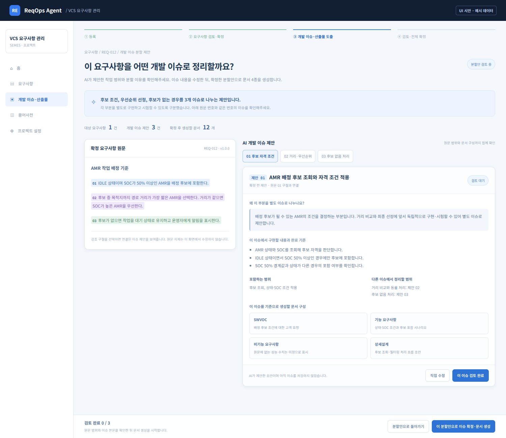
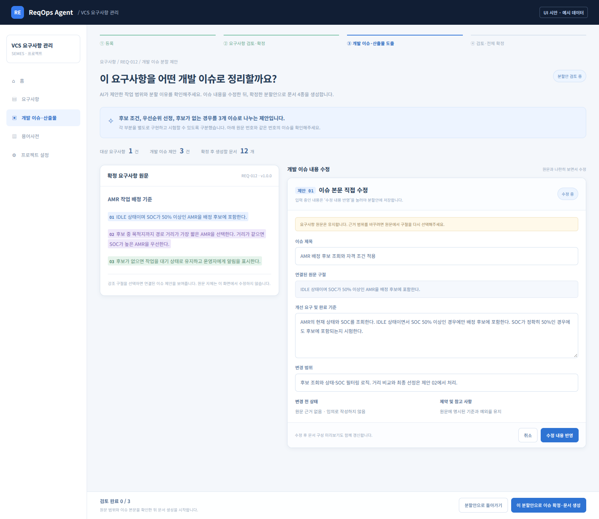
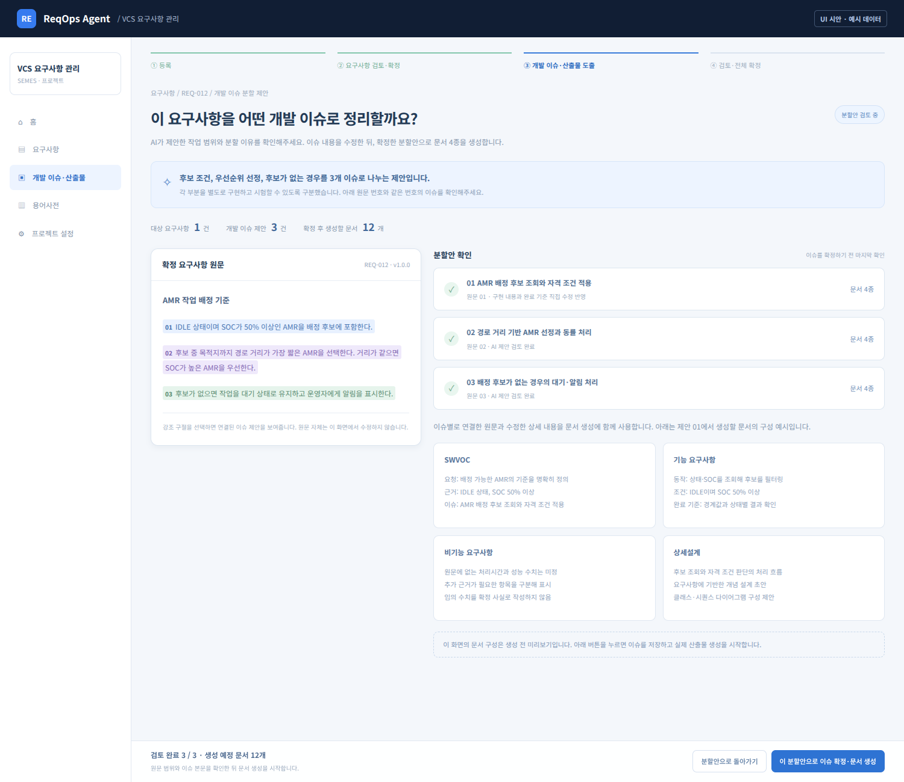

# 개발 이슈 분할 제안 화면 개선 계획

2026-10-30 · 대상: `/projects/{projectId}/requirements/{requirementId}/issues`

> 아래 이미지는 예시 데이터로 만든 UI 시안을 실제 브라우저에서 렌더링한 화면입니다. 현재 서비스에 이미 반영된 화면은 아닙니다. 이 문서는 계획과 시안만 먼저 올리며, 이슈 화면 구현은 검토 후 진행합니다.

## 1. 사용자가 바로 이해할 수 있어야 하는 내용

이 화면은 확정된 요구사항을 개발 작업 단위로 나누고, 각 작업을 어떤 문서로 정리할지 제안하는 단계입니다. 제목과 인용 구절만 보여주는 대신 다음을 한 화면에서 설명합니다.

- 이 요구사항을 몇 개의 개발 이슈로 나누는가?
- 어느 원문을 왜 별도 이슈로 구분했는가?
- 각 이슈에서 어떤 기능을 구현하고, 무엇을 확인하면 완료인가?
- 그 이슈의 내용을 SWVOC·기능·비기능·상세설계 문서에 어떻게 정리하는가?
- AI 제안을 사용자가 어디까지 수정했고, 확정하면 어떤 결과가 생성되는가?

화면 첫 안내는 다음처럼 씁니다.

> 이 요구사항은 후보 조건, 우선순위 선정, 후보가 없는 경우를 3개 개발 이슈로 나누는 제안입니다. 각 부분을 별도로 구현하고 시험할 수 있도록 구분했습니다.

제안과 저장된 이슈를 구분합니다. 저장 전에는 ‘제안 01’처럼 표시하고, 확정 후에는 서버가 부여한 실제 이슈 ID를 사용합니다.

## 2. 처음 진입: 원문과 분할 제안을 함께 확인

### 화면에서 보이는 것

| 영역 | 표시할 내용 | 사용자 동작 |
|---|---|---|
| 상단 안내 | 전체 분할 방향과 그 이유, 이슈 수, 생성 예정 문서 수 | 이 화면의 목적 파악 |
| 왼쪽 원문 | 확정 요구사항 전체, 이슈별 구절의 색상과 번호 | 구절을 선택해 해당 제안으로 이동 |
| 오른쪽 이슈 선택 | 제목·번호·검토 상태 | 제안별 전환 |
| 이슈 상세 | 분할 이유, 구현 내용, 완료 기준, 포함 범위와 다른 이슈의 범위 | 제안 내용 검토 |
| 문서 구성 | 이 이슈를 각 산출물에 어떤 내용으로 정리할지 설명 | 생성 결과의 방향 확인 |
| 하단 작업 | 직접 수정, 해당 이슈 검토 완료, 전체 분할안 확정 | 수정 또는 확정 |

### 예시에서 3개로 나누는 이유

| 원문 범위 | 제안하는 개발 이슈 | 구분 이유 |
|---|---|---|
| IDLE 상태이고 SOC 50% 이상인 AMR을 후보에 포함 | 후보 조회와 자격 조건 적용 | 어떤 AMR이 후보가 되는지 먼저 결정하는 기능 |
| 최단 경로 거리와 SOC 동률 처리 | 거리 기반 선정과 우선순위 처리 | 후보 중 최종 AMR을 고르는 별도 판단 기능 |
| 후보가 없을 때 대기와 운영자 알림 | 후보 없음 처리 | 정상 선정과 구분되는 예외 처리 기능 |

한 문장마다 무조건 이슈를 만들지 않습니다. 구현 책임과 시험 기준을 기준으로 묶고, 이슈 간 경계가 왜 필요한지 설명합니다. 원문의 조건·예외·경계값을 임의로 삭제하지 않습니다.

## 3. 이슈 상세를 읽고 직접 수정

### 수정할 내용

- **이슈 제목:** 구현할 작업을 설명하는 제목.
- **개선 요구 및 완료 기준:** 무엇을 구현하고 어떤 조건으로 확인할지 서술.
- **변경 범위:** 이 이슈에서 다루는 기능과 다른 이슈로 넘기는 범위.
- **제약 및 참고 사항:** 원문에 명시된 제약과 사용자가 추가한 설명.
- **변경 전·후 상태:** 원문 근거가 있는 내용만 작성. 근거가 없는 변경 전 상태를 AI가 지어내지 않음.
- **연결된 원문:** 별도 선택 동작으로 원문의 연속 구절을 선택. 원문과 무관한 문장을 인용처럼 입력하지 않음.

기존 `IssueInput`이 지원하는 상세 필드를 활용합니다. 화면에서는 산출물 상세처럼 항목명과 내용을 구분해 보여주고, 직접 수정 모드를 열어 입력합니다.

### 반영 규칙

1. 입력 중에는 확정된 분할안이나 DB를 바꾸지 않습니다.
2. **수정 내용 반영**을 누르면 현재 제안에 저장하고 ‘직접 수정 반영’으로 표시합니다.
3. 이슈를 바꿔 보더라도 작성 중인 입력은 유지합니다. 미반영 입력이 있으면 전체 확정 전에 반영·취소하도록 안내합니다.
4. **취소**하면 미반영 입력만 버리고 직전 반영 상태로 돌아갑니다.
5. **AI 다시 제안**은 사용자 수정 내용을 조용히 덮어쓰지 않습니다. 변경된 항목을 보여주고 새 제안을 채택하는 동작을 분리합니다.

이슈를 추가·삭제·합치거나 나눴으면 원문 연결과 문서 구성을 다시 확인합니다. 합치기는 원문에서 연속한 범위를 선택할 수 있을 때 처리합니다. 떨어진 두 구절을 문자열로 이어 붙여 원문에 없는 인용 구절을 만들지 않습니다. 이슈 순서나 제목만 바뀐 경우에는 기존 이슈 ID·연결을 유지합니다.

## 4. 분할안을 확정하기 전 결과 확인

이슈별 검토 상태, 원문 연결, 반영한 직접 수정 내용을 요약합니다. ‘문서 구성’은 실제 생성 완료 결과와 구분해 **생성 전 미리보기**로 표시합니다.

시안의 3개 이슈는 각각 4종을 생성하므로 총 12개 문서를 만들 예정입니다.

| 산출물 | 이슈에서 가져올 내용 |
|---|---|
| SWVOC | 고객 요청, 배경과 원문 근거 |
| 기능 요구사항 | 동작·조건·예외와 완료 기준 |
| 비기능 요구사항 | 원문에 명시한 제약. 처리시간·성능 수치가 없으면 미정 또는 추가 확인으로 구분 |
| 상세설계 | 요구사항과 이슈에 근거한 처리 흐름·클래스·시퀀스 설계 초안 |

버튼은 **이 분할안으로 이슈 확정·문서 생성**으로 표시합니다. 누르기 전에는 실제 이슈를 생성하지 않습니다. 누르면 사용자가 반영한 이슈 본문을 저장하고, 이 저장 결과를 기준으로 실제 산출물을 생성합니다. 확정 직전에 AI가 새로 작성한 본문으로 사용자 입력을 덮어쓰지 않습니다.

상세설계는 요구사항에 기반한 개념 설계 초안입니다. 실제 장비 코드에서 확인한 클래스나 실행 결과로 표시하지 않습니다.

## 5. 로딩·실패·재진입

| 상황 | 화면 동작 |
|---|---|
| 최초 제안 생성 | ‘개발 이슈의 범위와 상세 내용을 제안하고 있습니다’ 표시 |
| AI 응답 실패 | 원문과 사용자 입력 유지. 제안 생성 실패 원인과 다시 요청 동작 표시 |
| 확정·문서 생성 시작 | 이슈 저장과 문서 생성 단계를 구분. 중복 클릭 방지 |
| 산출물 일부 실패 | 성공한 결과는 유지하고 실패한 문서만 재요청 가능하도록 설계 |
| 원문 또는 확정 버전 변경 | 이전 제안을 최신 제안처럼 적용하지 않고 새 기준으로 재검토 안내 |
| 저장된 이슈가 있는 상태로 재진입 | 자동으로 다른 화면으로 보내지 않고, 저장된 분할안·문서를 표시해 수정 또는 결과 열기 제공 |
| 좁은 화면 | 원문, 이슈 선택, 이슈 상세 순서로 한 열 배치 |

## 6. 구현할 데이터와 요청 흐름

현재 최초 제안 API는 제목과 원문 구절만 돌려주고, 상세화는 확정 버튼을 누른 뒤 수행합니다. 새 화면에서는 **상세화와 분할 이유를 확정 전에 제공**해야 합니다.

1. 백엔드는 대상 요구사항의 확정 본문과 버전, 같은 프로젝트의 다른 요구사항 전체, 용어 문맥을 확보합니다.
2. AI가 개발 이슈의 범위·제목·분할 이유를 제안합니다.
3. 제안별 상세 본문과 산출물 구성 설명을 작성합니다. 각 요청에 대상 본문과 기존 요구사항 전체 문맥을 유지합니다.
4. 서버가 제안 식별자와 원문 구절·위치·버전을 연결하고 반환값을 검증합니다.
5. 사용자는 원문과 제안을 비교하고 이슈 상세 내용을 수정합니다.
6. 확정 요청은 사용자가 반영한 본문을 포함합니다. 서버는 권한·원문 연결·입력 기준·중복과 누락을 확인하고 저장합니다.
7. 저장된 이슈 ID와 본문으로 산출물 4종 생성을 요청합니다.

다음 필드는 **추가할 설계안**입니다. 현재 응답에 이미 있는 필드라는 뜻이 아닙니다.

| 구분 | 기존·활용 가능 | 추가 설계 |
|---|---|---|
| 제안 기본 | `title`, `quote` | 제안 식별자, 분할 이유, 원문 범위, 기준 버전 |
| 상세 본문 | `symptom`, `improvementReq`, `changeScope`, `constraintsNote`, `beforeState`, `afterState` | 제안 단계에서도 상세 본문 제공 |
| 문서 구성 | 기존 산출물 4종 | 생성 전 문서별 구성 설명 |
| 사용자 결정 | 이슈 확정 요청 | 검토 상태, 사용자 반영 내용, 재요청 시 보존 상태 |

최근 수정한 `/issues/enrich`의 원칙을 유지합니다. 제목·원문 구절은 서버가 보존하고, AI 응답 순서만 믿고 이슈 본문을 연결하지 않습니다. 선택한 이슈의 상세 본문이 다른 이슈에 붙지 않도록 식별자로 검증합니다.

## 7. 완료 기준과 적용 순서

- 사용자가 화면만 보고 분할 목적·근거·문서 생성 결과를 이해할 수 있어야 합니다.
- 확정 전에 이슈별 상세 본문을 읽고 수정할 수 있어야 합니다.
- 원문 구절과 선택한 제안이 양방향으로 연결되어야 합니다.
- 수정·삭제·합치기·나누기 후에도 원문 연결이 정확해야 합니다.
- AI 재요청과 오류 때문에 사용자 입력을 잃지 않아야 합니다.
- 저장된 이슈를 다시 열어도 기존 ID·문서·Jira 연결을 보존해야 합니다.
- 저장과 실제 생성은 최종 확정 동작에서 수행해야 합니다.

**먼저 이 계획서와 시안만 올립니다.** 이슈 분할 화면은 검토 후 구현합니다. 별도 요청한 요구사항 edit 화면의 ‘본문 무변경 시 고객 합의 생략’과 ‘합의할 최종 본문 넓게 보기’는 이어서 개발합니다.

[브라우저에서 열 수 있는 시안 HTML](plans/issue-proposal/preview.html) · GitHub에서는 내려받아 브라우저로 열면 화면 전환 버튼을 사용할 수 있습니다.
