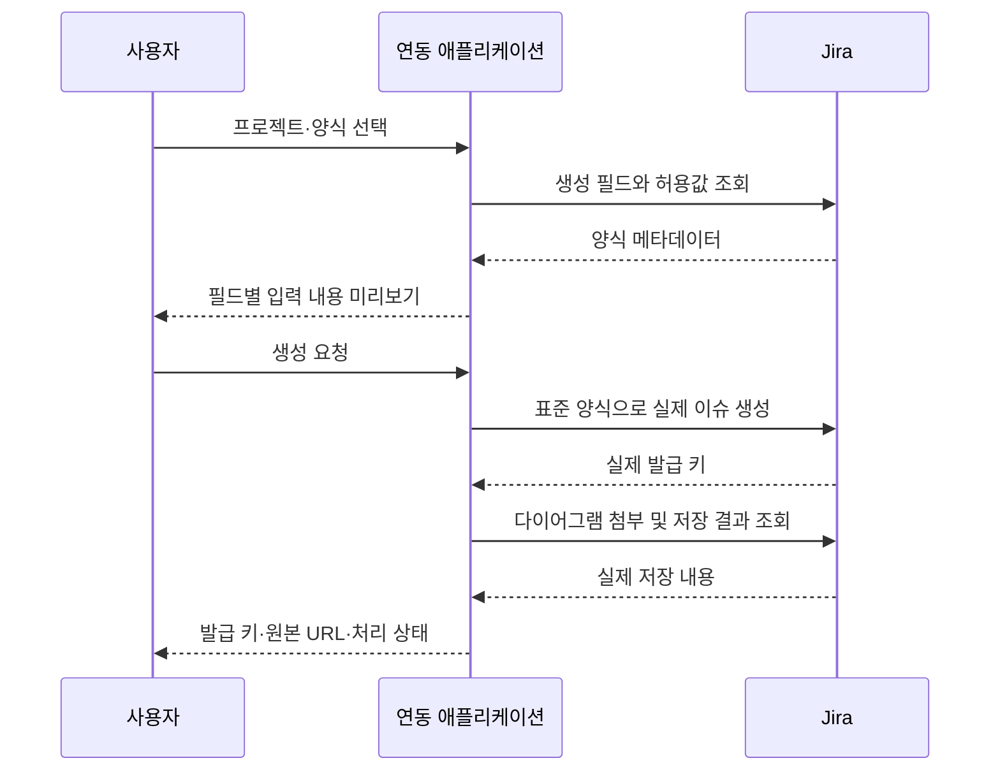

# 표준 Jira 양식으로 생성하고 실제 Jira 화면을 한 페이지에서 보는 설계

작성일: 2026-11-03

이 문서는 공개된 Jira/브라우저 공식 문서에 근거한 일반 설계다. 실제 사내 주소, 설정값, 이슈 내용, 인증 정보, 내부 구현 경로는 포함하지 않는다. 대상 Jira의 버전·필드·SSO·응답 헤더는 아직 실서버에서 확인하지 않았다. 문서 작성과 실제 기능 구현을 구분한다.

## 1. 가능한가?

| 원하는 결과 | 답 | 전제 |
| --- | --- | --- |
| 평소 양식대로 실제 Jira 이슈 생성 | 가능 | 프로젝트·이슈 유형·필드·필수값·템플릿을 실제 설정에 맞게 매핑 |
| 생성된 Jira 화면을 웹페이지 안에 그대로 표시 | 조건부 가능 | Jira와 로그인 시스템이 iframe 표시를 허용하거나 관리자가 지원하는 배치 구성 필요 |
| 여러 실제 Jira 화면을 한 페이지에서 확인 | 위 조건을 충족하면 가능 | 이슈별 원본 URL을 패널로 배치하고 브라우저 로그인·성능 검증 |
| 설정 변경 없이 실제 Jira 데이터를 한 페이지에 표시 | REST 조회 방식으로 가능 | 직접 그린 화면이므로 Jira 원본 UI 그대로는 아님 |

추천 순서는 **기존 이슈 한 건의 양식 확인 + 원본 화면 임베딩 시험 → 같은 양식으로 실제 이슈 생성 → 여러 원본 화면 통합**이다. 원본 화면이 필수라면 임베딩 가능성을 먼저 확인해야 한다.

## 2. 평소 사용하는 Jira 양식대로 실제 이슈 생성

### 2.1 본문만 비슷하게 만드는 것과 다르다

일반적인 연동이 개발 이슈와 문서를 설명 필드 하나로 합쳐 보내는 수준이라면, 사내 양식을 재현하려면 필드별 매핑을 추가해야 한다.

| 맞출 대상 | 처리 방향 |
| --- | --- |
| 프로젝트·이슈 유형 | 실제 프로젝트와 이슈 유형으로 생성 |
| 현상·개선 요구·변경 범위·제약 | 해당 커스텀 필드 또는 회사 본문 절에 각각 매핑 |
| 요청자·담당자·기한·우선순위 | 실제 필드의 자료형·허용값·권한에 맞춰 입력 |
| 기본 문구·표·목차 | 기존 양식의 문서 구조를 보존해 변환 |
| 템플릿 앱·자동화 | API 생성에도 동일하게 적용되는지 확인 |
| 상위 이슈·관련 문서 | 현재 운영하는 이슈 관계에 맞춰 연결 |

Jira REST API는 실제 이슈 생성과 커스텀 필드 입력을 지원한다. 필드 표시 이름만으로 처리하지 않고 실제 필드 ID·필수 여부·자료형을 확인한다. 화면 템플릿 앱이 넣는 문구까지 생성 메타데이터가 자동 복원해 주는 것은 아니므로 정상 작성된 기존 이슈 및 관리자 설정과 비교한다. 앱 전용 필드는 별도 API 지원 여부를 확인해야 한다. [1][2]

### 2.2 버전과 필드 조회

제품/버전을 먼저 확인한다. Server/Data Center와 Cloud API 규격을 혼용하지 않는다. 공식 REST 문서를 기준으로 다음 정보를 조회한다.

- 프로젝트와 이슈 유형.
- 생성 가능한 필드, 필수 여부, 기본값과 허용 옵션.
- 정상 작성된 기존 이슈의 필드 값과 표시 형식.
- 사용자 계정과 생성·조회·첨부 권한.

Jira 8.4 이상 계열의 공식 생성 메타데이터 예시는 다음과 같다. 실제 사용 가능 여부와 페이지네이션은 설치 버전에서 확인한다. 구형 통합 `createmeta` 경로는 Jira 9.0에서 제거되었다고 안내되어 있다. [2]

```text
GET /rest/api/2/issue/createmeta/{projectIdOrKey}/issuetypes
GET /rest/api/2/issue/createmeta/{projectIdOrKey}/issuetypes/{issueTypeId}
POST /rest/api/2/issue
```

이슈 키와 커스텀 필드 ID를 AI가 임의로 만들게 하지 않는다. 선택 필드와 사용자 필드도 각 스키마에 맞는 식별자/객체를 사용한다. 작업 상태 변경이 필요하면 허용된 워크플로 전환을 별도로 확인한다.

### 2.3 생성 과정



생성 결과는 다시 Jira에서 읽어 저장 값을 확인한다. 브라우저 세션에서만 채워지던 기본값이 빠지지 않았는지 기존 정상 이슈와 비교한다.

### 2.4 이슈 개수는 운영 양식에 맞춘다

개발 이슈 하나에 문서 4종을 넣는 구조라면 개발 이슈 4개는 Jira 이슈 4개다. 문서마다 별도 Jira 이슈를 만드는 운영 방식이면 문서별 생성과 연결 관계가 필요하다. 개발 이슈 4건과 문서 16건을 모두 독립 이슈로 만들면 20건이며, 문서만 이슈로 관리하면 16건이다. 문서 수를 곧 Jira 이슈 수로 고정하지 않는다.

## 3. 텍스트·표·시퀀스 다이어그램도 Jira에 표시

Jira는 필드별 렌더러가 다를 수 있다. 따라서 웹페이지용 Markdown을 그대로 보내는 것만으로 회사의 Jira 양식과 같은 표·제목·이미지가 보인다고 가정하면 안 된다. 실제 렌더러에 맞게 변환한다. [3]

다이어그램은 다음 순서로 처리한다.

1. Jira에 이미 사용 중인 다이어그램 앱이 있는지 확인한다.
2. 앱이 있으면 그 앱이 지원하는 필드·매크로·첨부 형식으로 저장한다.
3. 없으면 애플리케이션에서 PNG를 생성해 Jira에 첨부하고, 지원되는 렌더러 형식으로 본문에서 참조한다.
4. Mermaid 원문은 별도로 보존할 수 있다. 코드 문자열을 넣었다고 자동으로 그림이 되는 것은 아니다.
5. 실제 Jira 이슈 화면에서 이미지와 표가 정상 표시되는지 확인한다.

Jira REST API는 이슈 첨부를 지원한다. 이미지도 Jira가 접근할 수 있는 첨부로 저장해야 하며 특정 브라우저에만 존재하는 `blob:` 주소를 본문에 넣지 않는다. 이미지 생성은 사내에서 실행 가능한 렌더러 또는 브라우저 내보내기를 사용한다. [4]

## 4. 실제 Jira 페이지를 그대로 표시하는 조건

### 4.1 실제 원본 화면의 의미

실제 `/browse/{issueKey}` 페이지를 iframe으로 표시하면 Jira가 제공하는 원본 화면이 나타난다. 필드·댓글·첨부·설치 앱 화면도 Jira가 표시하며, 그 안에서 수정하면 실제 Jira에 반영된다.

원본 페이지의 상단 메뉴까지 함께 나올 수 있다. 임의로 전체 HTML을 복사해 주입하는 방식이나, 공개되지 않은 URL 옵션으로 본문만 항상 잘라낼 수 있다는 가정은 사용하지 않는다.

### 4.2 iframe을 추가하기만 하면 되지 않는 이유

Atlassian은 Jira의 보안 헤더가 iframe 포함을 차단할 수 있다고 설명한다. 공식 문서의 정책 예시는 다음과 같다. 대상 Jira의 실제 반환값은 별도로 확인해야 한다. [5]

```http
X-Frame-Options: SAMEORIGIN
Content-Security-Policy: frame-ancestors 'self'
```

origin은 프로토콜·호스트·포트의 조합이다. 같은 사내망이나 같은 상위 도메인이라는 것만으로 같은 origin이 되지 않는다. 포트가 달라도 다른 origin이다. [6]

| 확인 항목 | 이유 |
| --- | --- |
| Jira와 앞단 프록시의 프레임 정책 | 원본 페이지 포함 허용 여부 |
| Jira의 `frame-ancestors` | 부모와 그 상위 프레임까지 허용되는지 [7] |
| 애플리케이션의 `frame-src` | Jira를 프레임으로 불러올 수 있는지 |
| SSO 리다이렉트와 최종 응답 | 로그인 과정도 프레임에서 동작하는지 |
| 브라우저 쿠키 정책 | 다른 사이트로 분류될 때 로그인 쿠키를 사용할 수 있는지 [8] |
| HTTPS/HTTP 조합 | mixed content 차단이 발생하는지 [9] |

CORS 허용과 iframe 표시 허용은 다른 문제다. API 토큰이 있다고 iframe이 자동 로그인되는 것도 아니다. iframe은 사용자의 Jira/SSO 세션으로 표시하며, `onLoad` 이벤트만으로 정상 표시를 확정하지 않는다. [5][10]

### 4.3 가능한 배치 방식

**A. 관리자가 지원하는 동일 origin 배치**

연동 애플리케이션과 Jira를 같은 프로토콜·호스트·포트의 서로 다른 경로로 제공하는 구성을 검토한다. 같은 origin이면 위의 `SAMEORIGIN`/`'self'` 조건을 만족할 수 있다. 이는 브라우저 규칙을 적용한 설계 제안이며 대상 서버에서 검증한 구성은 아니다. [5][6]

애플리케이션의 기본 경로, 정적 자원, API 라우팅, Jira context path, SSO, 쿠키와 CSP를 함께 검증한다. 같은 origin 배치는 보안 경계에도 영향을 주므로 관리자와 결정한다.

**B. 별도 origin에서 허용되는 임베딩**

관리자가 버전·프록시·SSO 정책에 맞춰 허용할 수 있는지 검토한다. CSP를 바꾸더라도 충돌하는 X-Frame-Options 정책이 남으면 안 된다. Jira 전체의 보호 기능이나 브라우저 보안을 무조건 끄는 것을 기본 해법으로 삼지 않는다.

**C. Jira 내부 통합 페이지**

Jira의 web panel, dashboard/gadget 확장 지점으로 관련 이슈를 모으는 진입점을 검토할 수 있다. Jira 앱 설치와 호환성 확인이 필요하다. 대시보드 목록과 여러 원본 이슈 화면 전체의 동시 표시는 다르므로 요구 충족 여부를 구분한다. [11][12]

### 4.4 인증 구분

API 호출에 필요한 인증과 브라우저 원본 화면의 로그인은 각각 확인한다. PAT를 지원하는 버전과 발급 정책도 다를 수 있다. 인증 정보는 서버에 보관하고 iframe URL이나 프런트 코드에 넣지 않는다. [13]

## 5. 여러 이슈를 한 페이지에서 보는 구성

| 영역 | 화면 제안 |
| --- | --- |
| 상단 | 연결된 실제 Jira 이슈 수, 생성/미생성/실패 상태 |
| 왼쪽 | 개발 이슈와 실제 Jira 키 목록, 프로젝트 필터 |
| 기본 본문 | Jira 원본 화면 패널을 한 페이지에 연속 배치 |
| 비교 | 선택한 두 원본 화면 나란히 보기 |
| 패널 도구 | Jira 키, 확대, 원본 새 탭 링크 |

여러 Jira 페이지의 자원이 동시에 로드되므로 보이는 패널부터 불러오되 전체 펼치기를 제공한다. 각 프레임에 충분한 높이와 내부 스크롤을 제공한다. 다른 origin의 DOM을 읽어 자동 높이 계산·메뉴 제거·편집 버튼 제어가 가능하다고 가정하지 않는다. [6][10]

## 6. 원본 화면 표시가 허용되지 않을 때

| 방식 | 실제 데이터 | 원본 Jira UI 그대로 | 한 페이지에 여러 건 |
| --- | --- | --- | --- |
| 실제 Jira iframe | 예 | 예, 표시 조건 충족 필요 | 조건 충족 시 가능 |
| Jira 내부 대시보드/앱 | 예 | Jira 내부의 별도 목록/패널 구성 | 가능 |
| REST 조회 후 자체 화면 표시 | 예 | 아니오 | 가능 |
| 원본 새 탭 | 예 | 예 | 별도 탭 |

REST 대안은 Jira에서 현재 필드·댓글·첨부를 읽어 화면을 구성하고 조회 시각을 표시하는 방식이다. `renderedFields`는 필드의 HTML이며 **전체 Jira 화면을 반환하는 API는 아니다.** 이 대안을 원본 화면 그대로라고 설명하면 안 된다. [4]

## 7. 실제 도입 시 확인할 자료와 구현 순서

필요한 자료는 정상 작성된 이슈 한 건의 양식, 프로젝트/유형/필드 정보, 템플릿·다이어그램 앱 여부, 허용 인증 방식, 로그인한 원본 페이지의 헤더다. 실제 이슈 내용과 인증 정보는 사내에서 확인하고 공개 저장소에는 넣지 않는다.

1. **원본 화면 한 건 시험 + 양식 조사.** 로그인된 이슈의 최종 응답과 SSO 리다이렉트를 확인한다. 로그인 전 응답만 보고 임베딩 가능 여부를 판단하지 않는다.
2. **같은 양식으로 테스트 이슈 한 건 생성.** 필수 필드, 기본값, 표와 첨부를 기존 정상 이슈와 비교한다.
3. **다이어그램과 문서 연결.** 생성된 실제 이슈를 다시 조회해 저장 결과를 확인한다.
4. **여러 원본 화면 통합.** 결정한 배치에서 로그인 유지·권한·댓글·첨부·모바일 스크롤을 검증한다.
5. **실패 복구 검증.** 이슈 생성 뒤 첨부가 실패하면 같은 이슈에 첨부만 재시도한다. 생성 응답이 불명확하면 기존 생성 여부를 확인하기 전 생성 요청을 반복하지 않는다.

완료 기준은 **평소 양식으로 실제 Jira 이슈가 생성되고, 결정한 방식으로 그 이슈들을 확인할 수 있는 것**이다. 원본 화면이 필수라면 자체 UI나 새 탭만 구현한 상태를 완료로 보지 않는다.

## 8. 공식 근거

이 문서의 배치 구성과 화면 구성은 아래 공식 기능을 적용한 제안이다. 대상 사내 서버에 대한 연결·필드·헤더·SSO 검증은 수행하지 않았다.

1. [Atlassian: 이슈 생성과 커스텀 필드](https://developer.atlassian.com/server/jira/platform/jira-rest-api-example-create-issue-7897248/)
2. [Atlassian: 버전별 생성 메타데이터](https://developer.atlassian.com/server/jira/platform/jira-rest-api-examples/)
3. [Atlassian: 필드 렌더러](https://confluence.atlassian.com/adminjiraserver104/configuring-renderers-1527942426.html)
4. [Atlassian: Data Center 이슈 REST API](https://developer.atlassian.com/server/jira/platform/rest/v10000/api-group-issue/)
5. [Atlassian: 보안 헤더와 iframe 보호](https://support.atlassian.com/jira/kb/jira-security-headers-configuration/)
6. [MDN: Same-origin policy](https://developer.mozilla.org/en-US/docs/Web/Security/Defenses/Same-origin_policy)
7. [MDN: CSP frame-ancestors](https://developer.mozilla.org/en-US/docs/Web/HTTP/Reference/Headers/Content-Security-Policy/frame-ancestors)
8. [MDN: 서드파티 쿠키](https://developer.mozilla.org/en-US/docs/Web/Privacy/Guides/Third-party_cookies)
9. [MDN: Mixed content](https://developer.mozilla.org/en-US/docs/Web/Security/Defenses/Mixed_content)
10. [MDN: iframe](https://developer.mozilla.org/en-US/docs/Web/HTML/Reference/Elements/iframe)
11. [Atlassian: Web panel](https://developer.atlassian.com/server/jira/platform/web-panel/)
12. [Atlassian: Jira Gadget](https://developer.atlassian.com/server/jira/platform/gadget/)
13. [Atlassian: PAT](https://confluence.atlassian.com/enterprise/using-personal-access-tokens-1026032365.html)
