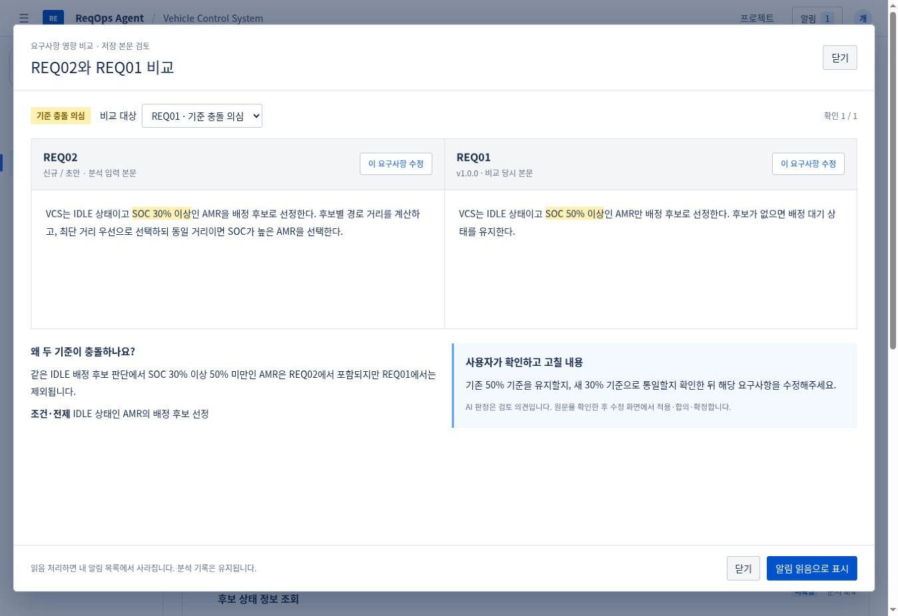
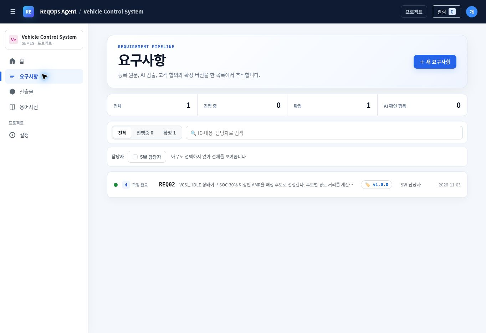
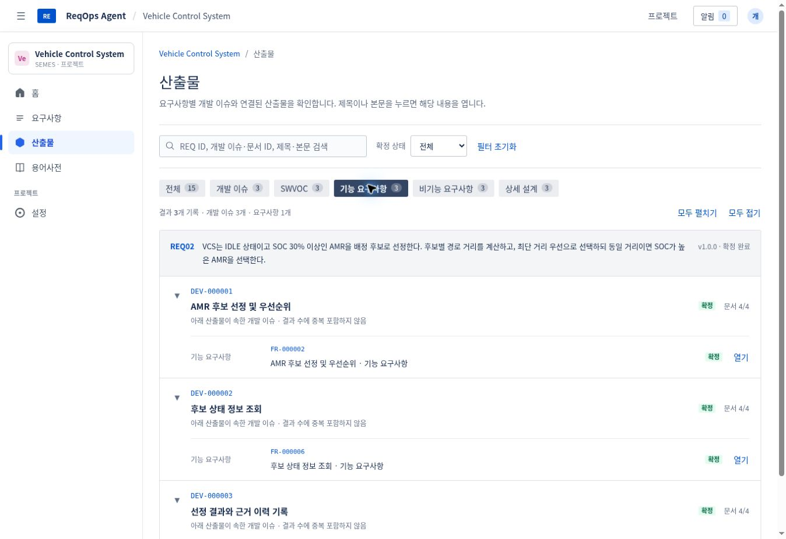

# 영향 알림·확정 상태·산출물 목록 반영

## 사용 방법

1. **DB**: 기존 V008까지 적용된 DB에서 `db/init.sql` 또는 `db/migrations/V009__requirement_impact_notifications.sql` 중 하나만 한 번 실행합니다. 이번 init은 새 알림 테이블 2개와 인덱스만 생성합니다. 기존 테이블·데이터는 변경하지 않습니다.
2. 백엔드와 AI 서버를 갱신·재시작합니다. 설정·서버 주소는 변경하지 않았으며 Python 의존성 추가도 없습니다.
3. 프론트엔드는 `frontend/dist/standalone`에 빌드된 파일을 사용합니다. 사내에서 npm 설치할 필요가 없습니다.
4. 기존 요구사항은 수정 화면의 **AI 다시 분석**을 실행하면 새 비교 결과가 생깁니다. 과거 분석을 알림으로 소급 생성하지 않습니다.

## 1. 알림과 비교

등록 시 저장된 본문을 AI 작업 큐로 분석합니다. `/analyze`는 기존 품질 검토를 유지하며 별도의 비교 프롬프트로 현재 전문과 프로젝트 내 기존 요구사항 전체를 확인합니다. 길면 대상별 배치로 나누되 현재 전문과 모든 기존 대상은 빠뜨리지 않습니다. 수정 화면의 재분석에는 변경 전 본문도 전달합니다. 수정 중 본문은 저장 완료로 표시하지 않고 **수정 중 본문 검토**로 구분합니다.

각 기존 ID마다 `CONFLICT / DEPENDENCY_REVIEW / NEEDS_REVIEW / NONE / UNREVIEWED`로 분류합니다. 영향 항목은 양쪽 원문 인용·동일 조건/관련 전제·구현/시험 결과 차이·사용자가 확인할 사항이 있어야 합니다. AI의 인용·ID를 Python과 Java에서 검증하며 누락·중복·잘못된 인용은 미확인입니다. 확인 수와 완료 여부는 서버가 계산합니다. AI 연결 실패도 영향 없음으로 처리하지 않습니다.

프로젝트 상단 알림함과 해당 요구사항 수정/상세 화면에 결과를 표시합니다. 5초 주기로 확인하며 창 복귀 때 다시 조회합니다. **내용 확인**은 최대 1440px, 화면 높이의 92%인 큰 팝업을 엽니다. 두 요구사항 전문을 좌우로 읽고 근거를 강조하며, 아래에 이유와 고칠 내용을 보여줍니다. 각 원문의 **이 요구사항 수정**으로 기존 수정·합의·확정 절차에 연결합니다. 휴대폰에서는 두 본문을 세로로 배치합니다.

**알림 읽음으로 표시**는 사용자별 읽음 기록을 저장하고 팝업을 닫습니다. 해당 사용자 알림함·카운트·본문 알림에서 제거되며 새로고침 후에도 되살아나지 않습니다. 다른 사용자의 알림은 유지됩니다. **영향 분석 기록**에서는 읽은 결과와 이전 분석을 열 수 있습니다. 읽음은 충돌 해결·합의 완료가 아닙니다. 입력과 비교 문맥이 같고 결과도 같으면 중복 알림을 만들지 않습니다. 새 분석은 이전 결과를 대체하며, 원문이나 비교 대상이 바뀐 결과는 기록에 변경 안내를 붙이고 현재 알림에서는 제외합니다.

API: `GET /api/v2/projects/{id}/impact-events?userId=...` (옵션 `requirementId`, `includeRead`), `POST /impact-events/{eventId}/read` (`userId`, 204). 프로젝트 멤버만 조회·읽음 처리하며 이벤트의 프로젝트도 검증합니다.

## 2. 확정했는데 도출 준비로 표시되던 문제

기존 요구사항 목록과 상세는 요구사항 상태가 `CONFIRMED`이면 무조건 3단계로 표시했습니다. **요구사항 확정**과 **개발 이슈·산출물 전체 확정**을 구분하지 않았기 때문입니다.

`WorkflowReadService`가 현재 요구사항 버전에 연결된 현재 작업 묶음의 저장 상태와 실제 이슈·문서 수를 조회합니다. 요구사항 목록·상세 DTO의 `workflow`와 산출물 목록이 같은 조회 모델을 사용합니다. 다른 버전에 속한 이전 작업 묶음은 현재 완료 상태로 사용하지 않습니다.

| 실제 저장 상태 | 표시 |
| --- | --- |
| 요구사항 확정, 도출 전 | 3 · 도출 준비 |
| 산출물 생성 중 | 3 · 산출물 생성 중 |
| 산출물 생성 완료, 전체 확정 전 | 4 · 산출물 검토 |
| 개발 이슈와 산출물 전체 확정 | **4 · 확정 완료** |

검토 화면은 `confirmBundle` 응답이 실제 `CONFIRMED`인지 확인하고 그 응답을 바로 반영합니다. 재조회 실패 때문에 이전 상태와 성공 메시지가 같이 남는 경로를 제거했습니다. 늦은 생성 작업 완료 콜백이 확정된 작업 묶음을 검토 상태로 낮추지 않도록 보호합니다. 이미 DB에서 전체 확정이 성공한 건은 다시 생성·확정하지 않아도 새 조회에서 올바른 상태가 나옵니다. 현장 DB를 직접 확인한 것은 아닙니다.

## 3. 프로젝트 산출물

`GET /api/v2/projects/{id}/deliverables?userId=...`가 요구사항 근거 → 개발 이슈 → 문서 4종을 한 번에 제공합니다. 작업 묶음·버전·이슈·문서를 각각 일괄 조회하며 이슈별 문서 요청을 반복하지 않습니다. 기본 목록은 요구사항 자체가 아닌 실제 도출된 개발 이슈와 문서입니다.

- 전체 / 개발 이슈 / SWVOC / 기능 / 비기능 / 상세 설계 종류 버튼
- 개별 이슈·문서의 확정 여부와 ID·제목·요구사항 본문 검색 조합
- 문서만 필터링해도 해당 요구사항·상위 개발 이슈 맥락 유지
- 필터 결과는 실제 기록 수로 계산하고 맥락용 부모는 중복 집계하지 않음
- 요구사항 ID·본문과 개발 이슈·문서 제목 모두 클릭 가능
- 이슈별 접기/펼치기, 모두 접기/펼치기, 개발 이슈 25개씩 페이지 표시

현재 API는 프로젝트 전체를 일괄 조회한 뒤 브라우저에서 필터·페이지를 계산합니다. 대규모 프로젝트의 서버 검색·커서 페이지네이션은 별도 확장 범위입니다.

## 검증과 제한

- 프론트엔드 TypeScript 검사·프로덕션 빌드·단위 테스트 36개 통과.
- AI 서버 테스트 158개 통과. 비교 근거, 누락/중복 ID, 미확인, 배치별 전문·전체 대상 보존 포함.
- 실제 React 화면과 CSS를 분리된 API fixture로 브라우저 검증: 알림 읽음 후 삭제·재조회, 큰 비교 팝업, 종류/상태 필터, 문서 열기, 개발 이슈 3개·산출물 12개 확정 후 상세/목록/새로고침에서 4단계 유지, 모바일 배치.
- 이 캡처와 브라우저 검증은 테스트 데이터이며 실제 Oracle·사내 LLM·Jira 통합 실행 결과가 아닙니다.
- Java 회귀 테스트를 추가했으나 이 환경에서 Maven Central DNS에 연결되지 않아 백엔드 의존성 해석·컴파일·테스트를 실행하지 못했습니다. DB 스크립트와 사내 서버 연결은 현장 환경에서 확인이 필요합니다.
