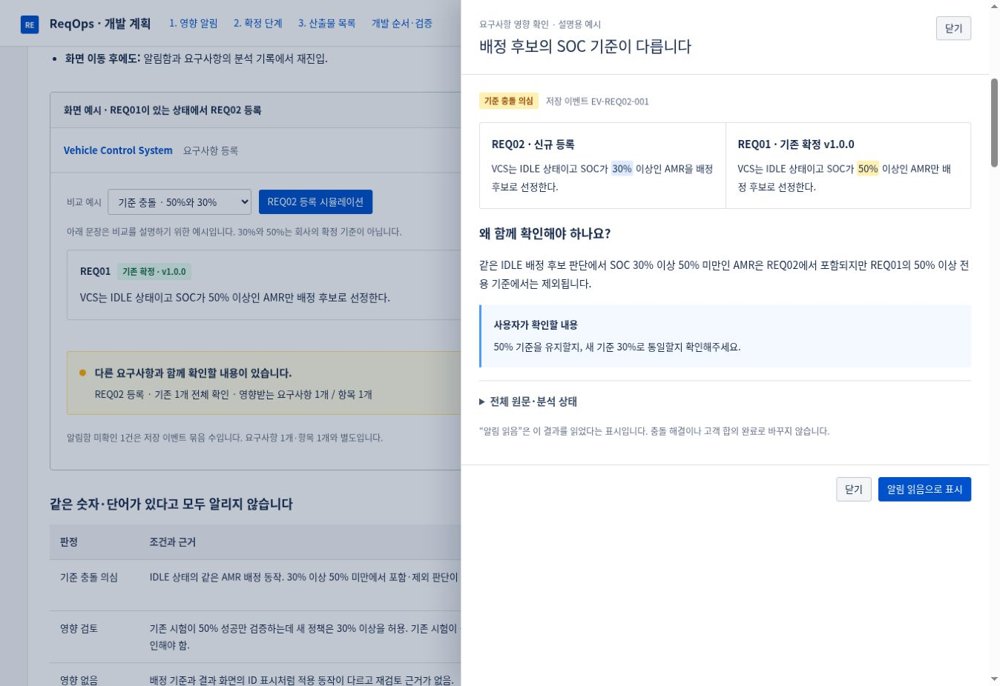

> 후속 구현: [변경 내용·적용 방법·검증 범위](../monitoring-workflow-implementation.md). 아래 문서와 HTML은 최초 계획 기록이며, 읽음 후 알림 삭제와 큰 비교 팝업은 후속 구현에서 반영했습니다.

# 영향 알림·확정 단계·산출물 목록 개발 계획

[클릭 가능한 전체 계획 HTML](monitoring-confirmation-artifacts-plan.html)을 다운로드해 브라우저로 열어주세요. 외부 리소스·서버 연결 없이 실행됩니다. 예시 데이터이며 실제 AI/DB 호출은 없습니다.

| 요청 | 제안 |
| --- | --- |
| 등록·수정 시 영향받는 요구사항 알림 | 저장 완료 후 분석 상태를 표시하고, 본문 요약 알림 + 저장 이벤트별 알림함 + 양쪽 원문 비교 패널 제공 |
| 산출물 확정 후에도 3단계 표시 | 요구사항 상태만 보던 고정 계산을 없애고 현재 버전의 최신 bundle 상태를 서버 공통 조회 모델로 제공 |
| 프로젝트 산출물 목록 | 요구사항 근거 → 개발 이슈 → 산출물 4종 구조. 종류·상태·검색 필터와 제목·내용 클릭 열기 |

HTML에는 기준 충돌·시험 기준 영향 검토·영향 없음·일부 미확인·실패, 알림 읽음 후 결과 유지, 확정 후 재진입, 종류별 결과 수와 부모 관계 유지, 요구사항·개발 이슈·문서 내용 열기를 시뮬레이션으로 넣었습니다. 확정 데모만 브라우저 sessionStorage를 사용합니다. 읽음은 해결·합의가 아닙니다.

현재 등록은 `RequirementService.create`에서 저장 후 분석 작업을 큐에 넣으며, `ReviewAnalysisStore.existing`이 같은 프로젝트의 자신을 제외한 요구사항 전문·상태·버전을 모읍니다. 현행 `/analyze`는 이미 품질·상충 검토를 수행합니다. HTML의 모니터링 SYSTEM은 기존 프롬프트에 추가할 비교 지침 제안이며, 요청·응답 확장과 대상별 검증·알림 저장 계획을 구분해 설명합니다.

확정 표시 문제는 `requirements/page.tsx.workflowStage`가 요구사항 `CONFIRMED`를 항상 `3 · 도출 준비`로 바꾸고, 요구사항 상세도 같은 조건으로 단계 3을 고르는 코드에서 확인했습니다. 목록 DTO에는 bundle 상태가 없습니다. 현장 DB의 실제 확정 성공 여부는 아직 확인하지 않았으며, 구현 시 confirm 응답·재조회·재진입을 함께 검증합니다. `useBundle.reload`의 내부 오류 처리도 구분해 보완할 계획입니다.

이번 변경은 **계획 HTML·설명 문서·화면 예시·README 링크만 추가**합니다. 제품의 알림 기능, 단계 표시, 산출물 목록은 이번 커밋에서 수정하지 않습니다. 개발 시에는 상태 표시 통일 → 산출물 조회 모델·목록 → 비교 결과 계약 → 알림·읽음 순으로 진행하며, 기존 양식·확정본 열람·폐쇄망 배포를 유지합니다.

