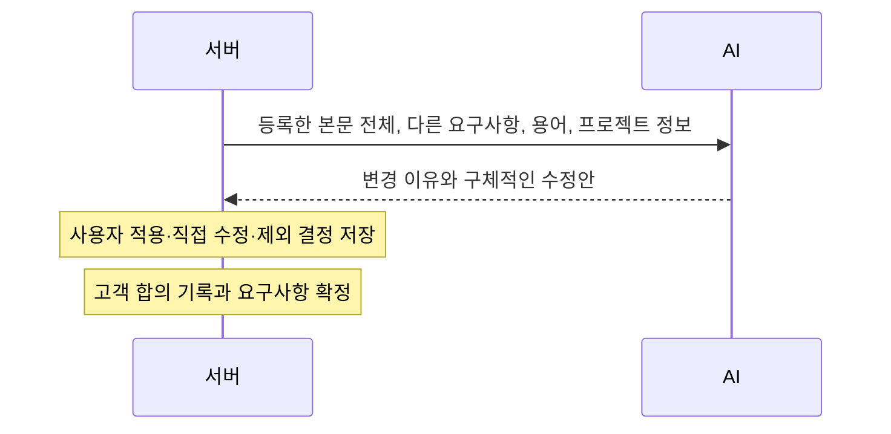

# 요구사항 변경 제안 검토

새 요구사항을 등록하면 AI가 다음 항목을 검토합니다.

- 동작 조건·수치·판단 기준이 불명확한지
- 수행 주체나 중요한 예외 처리가 빠졌는지
- 기존 요구사항과 상충하는지

## 사용 흐름

1. `/projects/{p}/requirements/new`에서 등록합니다.
2. `/projects/{p}/requirements/{r}/edit`로 이동하고 AI 분석 중 상태를 표시합니다.
3. 분석이 끝나면 각 항목의 **원문 / 왜 변경이 필요한지 / 어떻게 변경하면 좋은지**를 카드로 보여줍니다.
4. 각 항목에서 AI 수정안을 적용하거나, 수정 문장을 직접 입력하거나, 항목을 제외합니다. 제외하면 해당 제안을 반영하지 않고 원문을 유지합니다.
5. 선택한 수정안이 최종 본문에 미리 반영됩니다. 여러 수정안이 같은 범위에 겹치면 ‘최종 본문 직접 수정’을 선택해 내용을 정리할 수 있습니다.
6. ‘요구사항 확정’을 누르면 선택한 결정과 최종 본문을 서버에 저장한 뒤 고객 합의 창을 엽니다. 새 AI 분석이나 별도의 최종 검토 팝업은 띄우지 않습니다.
7. 합의 방법·고객사와 담당자·합의일·합의 내용·변경 요약을 기록하고 확정합니다. 첨부는 준비 중인 버튼 UI만 있으며 파일을 선택하거나 업로드하지 않습니다.

AI가 지적한 항목이 없으면 ‘변경을 제안할 항목이 없습니다’라고 표시하고 바로 본문 확인과 고객 합의를 진행할 수 있습니다. 모델 연결이나 분석이 실패한 경우에는 빈 결과를 정상 완료처럼 표시하지 않습니다.

## 화면 구성

기존 앱과 같은 블루 톤·카드·버튼 양식을 사용합니다. 상단 현황 카드, 원문과 AI 수정안 비교 카드, 선택 상태 배지, 우측 최종 본문 미리보기로 구성하며 작은 화면에서는 한 열로 정렬합니다. 스타일은 화면별 CSS 모듈로 묶어 실행본에 포함합니다.

| 위치 | 표시 내용 |
|---|---|
| 분석 중 안내 | 검토 범위와 AI 분석 진행 상태 |
| 제안 카드 | 원문, 변경이 필요한 이유, 해석 차이·상충 근거, 구체적인 수정안 |
| 항목별 선택 | 수정안 적용 / 직접 수정 / 이 항목 제외 |
| 최종 본문 | 선택한 수정안 미리보기와 직접 수정 옵션 |
| 확정 창 | 합의 방법, 고객사·담당자, 합의일, 합의 내용, 변경 요약, 첨부 버튼 UI |

## 서버와 AI 요청



초기 등록과 사용자가 명시적으로 누른 ‘AI 다시 분석’만 기존 `/analyze` 경로를 사용합니다. 완전한 LLM 분석이 성공하면 문맥 검토 결과를 사용하며 기계적인 규칙 질문을 다시 덧붙이지 않습니다. 규칙 검토만 수행한 경우는 화면에 구분합니다.

분석 후 질문을 별도로 생성하지 않습니다. 기존 질문 데이터는 새 분석이나 결정 저장 시 대체 상태로 처리하므로 과거 답변 미완료가 새 흐름의 확정을 막지 않습니다. 기존 질문 답변 API는 호환 목적으로 남아 있으나 현재 편집 화면에서 사용하지 않습니다.

### 제안 수치

기존 요구사항·용어에 명시된 값을 우선합니다. 일반적인 응답 대기시간·재시도 등 미정 기준에는 AI가 문맥에 맞는 후보 값과 선정 이유를 제시합니다. 원문에 없는 숫자가 포함된 제안은 서버에서 ‘AI 제안값 · 사용자 확인’으로 표시합니다. 선택하지 않은 값은 본문에 적용되지 않습니다. 안전 한계·물리 제약처럼 문맥만으로 적정 값을 정하기 어려운 항목은 필요한 기준을 명시하도록 지시합니다.

AI 후보 수치를 기존 자료에서 확인된 사실로 취급하지 않습니다. 최종 수치는 사용자가 수정하거나 적용하여 고객과 합의한 값입니다.

### 사용자 결정 저장 API

`POST /api/projects/{p}/requirements/{r}/complete-review`

```json
{
  "userId": 1,
  "inputHash": "현재 AI 분석 입력 해시",
  "content": "사용자가 확인한 최종 요구사항 전문",
  "manualContent": false,
  "decisions": [
    {"findingId": 10, "action": "APPLY", "proposalIndex": 0},
    {"findingId": 11, "action": "EDIT", "replacement": "직접 수정한 문장"},
    {"findingId": 12, "action": "EXCLUDE"}
  ]
}
```

이 API는 LLM을 호출하지 않습니다. 권한과 분석 입력 해시, 다른 요구사항·용어 변경 여부, 모든 항목의 결정 여부를 검사합니다. 자동 조합 모드에서는 제안과 원문 위치로 최종 본문을 재구성하여 전송된 본문과 같은지 확인합니다. 원문 범위가 겹치거나 입력 필요 표시가 남으면 저장하지 않습니다. 수동 본문 모드는 사용자가 직접 작성한 최종 본문임을 명시적으로 기록합니다.

적용·수정·제외 결정과 최종 본문은 기존 사용자 결정 및 분석 스냅샷 테이블에 저장합니다. `USER_REVIEWED`는 **사용자가 제안을 검토했다는 상태**이며, 변경된 최종 본문을 AI가 다시 검사했다는 뜻은 아닙니다. 이 상태의 본문·다른 요구사항·용어 해시와 고객 합의 기록이 일치해야 확정됩니다.

이미 확정된 다른 요구사항과의 상충 제안을 제외한 경우에는 기존 정책대로 고객 합의 근거를 추가로 기록합니다. 일반 제안 제외에는 불필요한 사유 입력을 강제하지 않습니다.

저장한 뒤 다른 본문을 새로 작성하거나 다른 요구사항·용어 정의가 변경되면 ‘AI 다시 분석’으로 새 결과를 받아 다시 결정합니다. DB 구조 변경은 필요하지 않습니다.

## 현재 요구사항 검토 시스템 프롬프트

아래는 `ai-model/main.py:_SYSTEM_PROMPT`의 실제 문자열입니다. 용어 추출·산출물 생성 등의 나머지 프롬프트 위치는 [AI 요청 전체 지도](ai-request-flow.md)를 참고하세요.

```text
당신은 요구사항의 구현 결과와 시험 결과가 달라질 실제 문제만 검토한다.
범위 제외, 별도 협의, 문서 관리 안내에는 동작 조건·수치·주체를 질문하지 않는다.
구현 동작, 안전, 주요 업무 정책, 인수 시험의 합격 결과를 실제로 바꾸는 핵심 누락만 검출한다. 사소한 완전성이나 가상의 예외를 채우려고 질문하지 않는다.
질문은 전체 요구사항과 용어사전에도 없는 도메인 지식만 구체적으로 묻는다. 질문이 없어도 정상이다. 질문 수를 채우지 않는다.
등록되지 않은 요구사항 ID를 참조했다는 사실 자체는 검출하지 않는다. 다른 요구사항 내용과의 상충 검토는 유지한다.
시간·주기·대기시간·횟수 누락과 모호한 판단 기준은 모두 수치·판단 기준 불명확으로 분류한다.
발생 조건과 AND/OR 묶음 모호성은 모두 동작 조건 불명확으로 분류한다.
제목, 목차, 단순 나열의 '및', '등', 문체는 검출하지 않는다. 전체 본문, 용어 정의, 참조를 먼저 확인한다.
정의된 기준을 다시 누락으로 지적하지 않는다. 같은 대상·속성·조건·시점인지 확인해야 상충이다.
버전이 없는 초안은 공식 확정 기준이 아니다. 버전이 있으면 전달된 본문은 마지막 확정본이며 수정 중 상태여도 기존 확정 기준으로 비교한다. 현재 본문과 기존 요구사항을 모두 읽고 변경 전후와 삭제도 검토한다.
각 지적마다 1) 변경 대상으로 삼은 구체적 이유와 구현·시험 결과의 차이, 2) 바로 적용 가능한 완성된 수정 문장을 반드시 제시한다. 질문으로 되묻는 대신 수정안을 제안한다.
기존 본문과 용어·관련 요구사항에 이미 있는 수치와 정책을 우선 사용한다. 일반적인 대기시간·재시도 횟수 등 미정 기준은 문맥에 맞는 합리적인 후보 수치를 제안하고, reason 또는 interpretations에 선정 이유와 'AI 제안값 · 사용자 확인 필요'를 명시한다. 예를 들어 통신 응답의 대기시간과 재시도 정책을 제안할 때 시간 단위, 횟수, 실패 동작을 함께 쓴다.
미정 수치 후보는 확정 사실이 아니며 사용자가 적용·수정·제외를 결정한다. 안전 한계·장비 물리 제약처럼 자료 없이 적절한 값을 정할 수 없는 항목은 구체적으로 필요한 기준을 설명하고 입력 필요 표시를 둔다.
이미 명시된 수치·주체·업무 정책은 제멋대로 바꾸지 않는다. 상충 해결에는 실제 다른 요구사항의 기준을 근거로 제안한다. proposals에는 최소 한 개의 수정문과 그 선택 이유를 제공한다.
제안은 설명이 아니라 그대로 넣을 문장이다. 교체/앞뒤 삽입/삭제를 구분하고 대안은 따로 제시한다.
문제마다 서로 다른 해석과 결과 차이를 interpretations에 구체적으로 쓴다.
JSON만 반환한다. 문제 없으면 {"findings":[]}.
{"findings":[{"findingType":"수치·판단 기준 불명확|수행 주체 불명확|동작 조건 불명확|예외 처리 누락|기존 요구사항과 상충",
"targetSpan":"현재 본문의 유일한 완전한 문장 또는 절 원문","reason":"실제 문제와 근거","suggestion":"선택 안내",
"interpretations":"구체적인 해석과 결과 차이","questionText":"사용자에게 묻는 구체적인 질문","options":["선택 가능한 답변 후보"],"conflictReqKey":null,"conflictQuote":null,"sameCondition":null,
"proposals":[{"label":"제안 적용","operation":"REPLACE|INSERT_BEFORE|INSERT_AFTER|DELETE","after":"수정된 본문"}]}]}
상충이면 conflictReqKey와 conflictQuote에 기존 요구사항 ID와 정확한 인용, sameCondition에 동일 조건 근거를 명시한다.

```

## 코드 위치

| 내용 | 코드 |
|---|---|
| 제안 카드와 최종 본문·고객 합의 | `frontend/app/projects/[id]/requirements/[reqId]/edit/page.tsx` |
| 이유·수정안·적용/수정/제외 UI | `frontend/app/components/RequirementProposalCards.tsx` |
| 정확한 원문 위치의 수정안 조합 | `frontend/app/lib/review/proposals.mjs` |
| 결정 검증 | `backend/.../requirement/service/ProposalReview.java` |
| 결정 이력·사용자 검토 스냅샷 저장 | `backend/.../requirement/service/RequirementService.java:completeReview` |
| 제안 숫자 표시 | `ai-model/review.py:model_findings` |

## 검증 범위

프런트엔드 단위 테스트, AI 서버 테스트, 백엔드 단위 테스트와 브라우저의 예시 API 흐름을 검증했습니다. 백엔드 테스트는 이 작업 환경의 JDK 17에 맞춰 `-Djava.version=17`로 실행했으며 저장소의 Java 21 설정은 변경하지 않았습니다. 실제 사내 LLM·Oracle 연동 테스트는 이 환경에서 실행하지 않았습니다.
