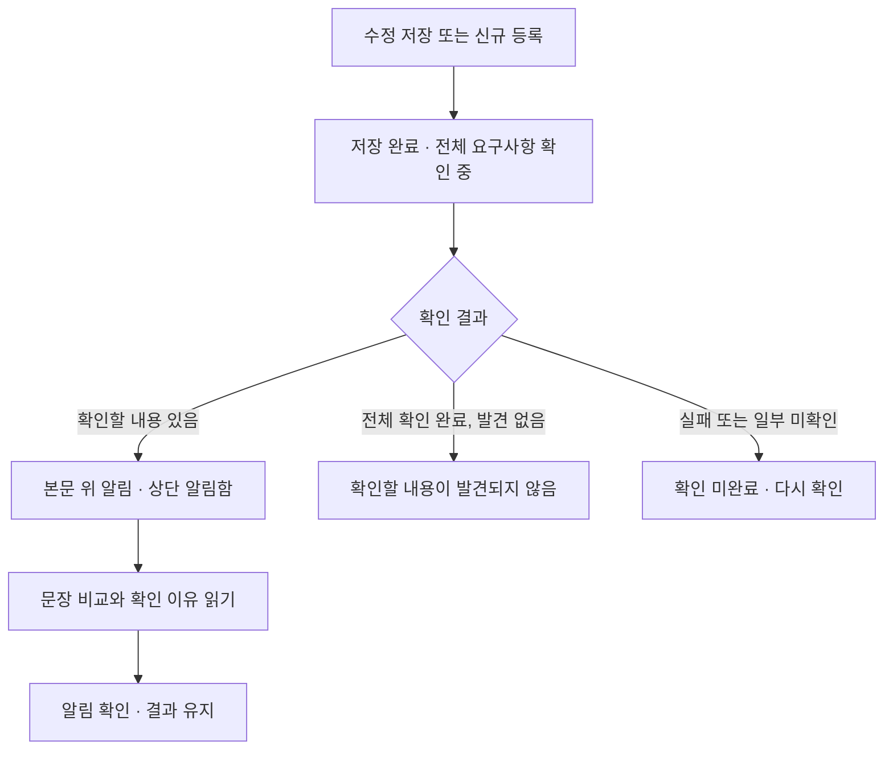

# 요구사항 간 확인 알림 — UI·UX 설계

2026-10-19 / 설계안. 기존 변경 영향·코드 근거 기능은 제거했습니다. 아래 알림 기능은 아직 서비스에 연결하지 않았습니다.

## 목적과 범위

요구사항을 수정하거나 추가했을 때 기존 요구사항과 함께 적용하기 어려운 부분을 사용자에게 알려줍니다. 사용자는 어떤 문장끼리 맞지 않는지와 왜 확인이 필요한지를 읽습니다. 본문 수정, 수정안 적용, 승인·반려, 담당자 지정, 충돌 해결 관리는 이번 범위에 포함하지 않습니다.

명칭은 **확인할 내용**입니다. AI가 찾아낸 의심 항목을 실제 결함으로 단정하지 않습니다. 단순히 문장이 비슷하거나 같은 숫자가 등장한다는 이유로 알리지 않습니다.

## 두 가지 진입 흐름

| 사용자 작업 | 비교 입력 | 비교 대상 | 결과를 처음 보여주는 위치 |
|---|---|---|---|
| REQ01~REQ10 중 REQ03 수정 저장 | REQ03 저장 전·후 전문 | 저장 시점의 나머지 9개 전문. REQ03의 이전 버전을 비교 대상으로 중복 등록하지 않음 | 수정 저장 완료 화면의 본문 위 알림 |
| REQ11 신규 등록 | REQ11 전문. 변경 전은 `신규 등록` | 등록 직전 REQ01~REQ10 전체 전문 | 등록 완료 화면의 본문 위 알림 |

저장은 먼저 완료합니다. AI 확인 때문에 저장 여부가 불명확해지지 않게 저장 상태와 확인 상태를 분리합니다. 매 글자 입력, 단순 화면 진입, 이슈 확정 때마다 같은 알림을 만들지 않습니다. 저장 내용이 실제로 바뀐 이벤트만 하나의 확인 작업을 만듭니다.

## 화면 구성

### 1. 저장 직후

- 수정: `REQ03을 저장했습니다. 기존 요구사항 9개와 함께 확인하고 있습니다.`
- 추가: `REQ11을 등록했습니다. 기존 요구사항 10개와 함께 확인하고 있습니다.`
- 생성 작업과 대기 시간을 구분할 수 있도록 `확인 대기` / `확인 중`을 표시합니다. 서버에서 실제 완료 수를 제공할 때만 `6/9 확인`처럼 진행률을 표시합니다.
- 사용자는 화면을 떠날 수 있습니다. 결과는 저장된 요구사항 상세와 상단 알림함에서 다시 찾습니다.

### 2. 결과 알림

본문 위에 작은 요약 영역 하나를 둡니다.

> **다른 요구사항과 함께 확인할 내용이 있습니다.**
> REQ03 수정 · 기존 요구사항 9개 확인 · 2개 요구사항에서 3개 항목 발견
> `[내용 확인]`

같은 대상에서 여러 항목이 나왔을 수 있으므로 요구사항 수와 항목 수를 구분합니다. 상단 알림함의 미확인 숫자는 **저장 이벤트별 미확인 결과 묶음 수**입니다. 요약의 `3개 항목`과 알림함의 `1`을 혼용하지 않습니다.

### 3. 상세 확인 창

기존 Jira 스타일 상세 창과 같은 넓이·색상·여백을 사용합니다.

- 상단: `REQ03 수정 후 확인할 내용`, 저장 시각, 비교 대상 수, 분석 기준 버전.
- 왼쪽: 확인 항목 목록. 대상 ID, 문장으로 된 문제 제목, 유형을 표시합니다.
- 오른쪽: 선택 항목의 두 원문을 나란히 배치하고, 아래에 확인 이유와 해당 조건에서의 구체적인 차이를 표시합니다.
- 수정 이벤트의 원인 문장 위에는 `50% 이상 → 30% 이상`처럼 실제 변경을 표시합니다. 추가 이벤트에는 화살표 대신 `신규 등록`을 표시합니다.
- 원인과 대상 모두 해당 원문의 연속 구절을 사용합니다. 긴 원문은 `전체 원문 보기`에서 읽기 전용으로 펼칩니다. 강조 구절만 잘라 맥락을 숨기지 않습니다.
- 문장 비교 영역에 요구사항 ID를 항상 함께 표시합니다. 모바일에서는 원인 문장 → 기존 문장 → 이유 순서로 쌓습니다.
- 창 하단: `닫기`, `알림 확인`. 수정·적용·충돌 해결 버튼은 없습니다.

### 4. 상단 알림함과 재진입

- 상단 종 아이콘에서 저장 이벤트별 결과 묶음을 확인합니다. 각 항목에 `REQ03 수정`, 문제 요약, 저장 시각, 미확인 표시를 제공합니다.
- 기존 요구사항 목록에는 해당 저장 버전에 연결된 `확인할 내용 3개`만 표시합니다. 이 표시는 해결 여부나 업무 진행률을 뜻하지 않습니다.
- 상세 창을 닫는 것만으로 읽음 처리하지 않습니다. `알림 확인`은 현재 사용자의 읽음 상태만 바꾸며, 항목을 삭제하거나 해결 완료로 바꾸지 않습니다.
- 확인한 결과도 요구사항 상세의 `이전 확인 결과`에서 다시 열 수 있습니다.

## 알림 분류와 예시

| 유형 | 알리는 조건 | 예시 제목 | 설명 방식 |
|---|---|---|---|
| 기준 불일치 | 같은 대상·상황의 수치·단위·비교 연산자가 다름 | `30% 이상~50% 미만 AMR의 후보 포함 여부가 다릅니다` | REQ03 `SOC 30% 이상을 배정 후보에 포함`과 REQ07 `SOC 50% 미만은 배정 후보에서 제외`를 비교. 두 조건에 동시에 해당하는 구간을 명시 |
| 동작 상충 | 같은 상황에 수행·금지 또는 서로 양립하기 어려운 동작이 있음 | `충전 중 AMR의 배정 허용 여부가 다릅니다` | 신규 REQ11 `충전 중에도 배정할 수 있다`와 REQ04 `충전 중에는 배정하지 않는다`를 비교 |
| 의미 확인 | 같은 조건인지 판단할 정보가 부족함 | `낮은 배터리의 범위를 확인해야 합니다` | REQ09 `배터리가 낮은 AMR 제외`에서 `낮은`의 기준이 없어 REQ03의 30% 조건과 같은 범위인지 확정할 수 없음을 표시 |

`SOC 30% 이상 배정`과 `SOC 30% 이하 충전 시작`은 대상 동작이 다릅니다. 같은 30%라는 이유만으로 기준 불일치로 분류하지 않습니다. 비교 결과에 근거가 없으면 문제를 만들어내지 않습니다.

## 상태와 문구

| 상태 | 사용자에게 보이는 문구 | 가능한 동작 |
|---|---|---|
| 대기 | `저장했습니다. 요구사항 확인을 기다리고 있습니다.` | 화면 이동 |
| 확인 중 | `기존 요구사항 9개와 함께 확인하고 있습니다.` | 화면 이동 |
| 완료·발견 있음 | `2개 요구사항에서 확인할 내용 3개가 있습니다.` | 내용 확인, 알림 확인 |
| 완료·발견 없음 | `기존 요구사항 9개를 확인했습니다. 확인할 내용이 발견되지 않았습니다.` | 확인 기록 보기 |
| 일부 미확인 | `9개 중 7개를 확인했습니다. 나머지 2개는 확인하지 못했습니다.` | 확인된 결과 보기, 다시 확인 |
| 실패 | `요구사항은 저장됐지만 다른 요구사항과의 확인을 완료하지 못했습니다.` | 다시 확인 |
| 이전 결과 | `확인 이후 REQ07 내용이 바뀌었습니다. 아래는 저장 당시의 결과입니다.` | 당시 결과 보기, 최신 내용 다시 확인 |

실패·시간 초과·누락 응답을 `문제 없음`으로 표시하지 않습니다. 경과 시간이나 AI 확신도를 임의의 점수·진행률로 표시하지 않습니다.

## 검토 입력·결과 계약 초안

새 구현은 기존 `/impact` API나 코드 스냅샷을 사용하지 않습니다. 요구사항 버전에 연결된 독립된 확인 작업으로 설계합니다.

입력은 프로젝트 ID, 원인 요구사항 ID·저장 버전, 이벤트 유형 `CREATED|UPDATED`, 저장 전후 전문, 나머지 요구사항 ID·버전·전문, 요청 시각, 입력 해시입니다. 검색으로 비슷한 일부만 보내거나 본문을 조용히 자르지 않습니다. 입력 한도를 넘으면 전체 확인을 못 했다고 표시합니다. 여러 묶음으로 나누는 구현을 선택할 때에도 모든 대상의 처리 상태를 수집하고 일부 결과를 전체 완료로 표시하지 않습니다.

각 대상은 `확인 완료·발견 없음`, `확인 완료·발견 있음`, `미확인` 중 하나를 반드시 반환합니다. 항목에는 원인 ID·대상 ID, 유형, 제목, 양쪽 원문 구절·위치, 확인 이유, 동시에 적용되는 조건·범위, 확정할 수 없는 내용이 포함됩니다. 원문에 없는 구절, 존재하지 않는 ID, 원인 자기 자신을 대상에 넣은 결과는 유효 결과로 취급하지 않습니다.

읽음 상태는 작업 결과와 분리합니다. 요청자는 입력 해시와 저장 이벤트 ID를 기준으로 중복을 막고, 완료 시 현재 버전과 비교하여 이전 결과 여부를 계산합니다. 요청 도중 더 최신 저장이 발생해도 이전 결과가 최신 결과를 덮어쓰지 않습니다. 다른 프로젝트의 요구사항이나 결과는 조회할 수 없습니다.

## 이번 변경의 구현 범위

기존 변경 영향 화면·상단 알림·자동 작업 생성·영향 API·소스 등록 API·소스 파서·코드 스냅샷 검증을 제거했습니다. 산출물 누락 검토와 요구사항 원문 근거 검사는 별도 `artifact-review` 서비스로 유지합니다. Detail Design은 요구사항에 기반한 **개념 설계 제안**으로 생성하며 실제 구현에서 확인된 클래스·호출이라고 주장하지 않습니다.

DB 스키마나 기존 요구사항 본문은 변경하지 않습니다. 기존 데이터에 남아 있는 옛 분석 기록은 사용하지 않습니다. 새 알림의 실제 API·작업·조회 UI 연결은 이 설계 검토 이후의 구현 범위입니다.

## 확인 기준

1. REQ03 수정 시 자신을 제외한 REQ01~REQ10 전체 9개를 비교한다.
2. REQ11 추가 시 기존 전체 10개를 비교한다.
3. 두 원문과 ID, 왜 함께 확인해야 하는지가 한 항목 안에 보인다.
4. 단순한 숫자 일치나 다른 대상의 정책 차이를 충돌로 단정하지 않는다.
5. 알림 확인·창 닫기·원문 보기는 어떤 요구사항도 수정하지 않는다.
6. 알림 확인 후에도 결과가 남고, 수정 완료로 표시되지 않는다.
7. 실패·누락·이전 결과와 정상 완료·발견 없음을 구분한다.
8. 모바일에서도 ID·강조 문장·이유·닫기·알림 확인에 접근할 수 있다.

## 이번 변경 검증 기록

- AI 서버: 규칙 제공자 테스트 환경에서 25개 통과. 삭제한 API 경로가 등록되지 않는지와 코드 등록 없이 Detail Design 생성·검증이 가능한지 확인했습니다.
- 백엔드: JDK 17 환경에서 `-Djava.version=17 clean test`로 17개 테스트 통과. 저장소의 기본 JDK 설정(21)은 변경하지 않았습니다. 사내 Oracle·LLM을 연결한 현장 검증은 별도입니다.
- UI 시안: 수정·추가 예시 전환, 항목 선택, 양쪽 원문 비교, 알림 확인 후 결과 유지, 닫기·다시 열기, 모바일 너비와 스크립트 오류를 확인했습니다.
